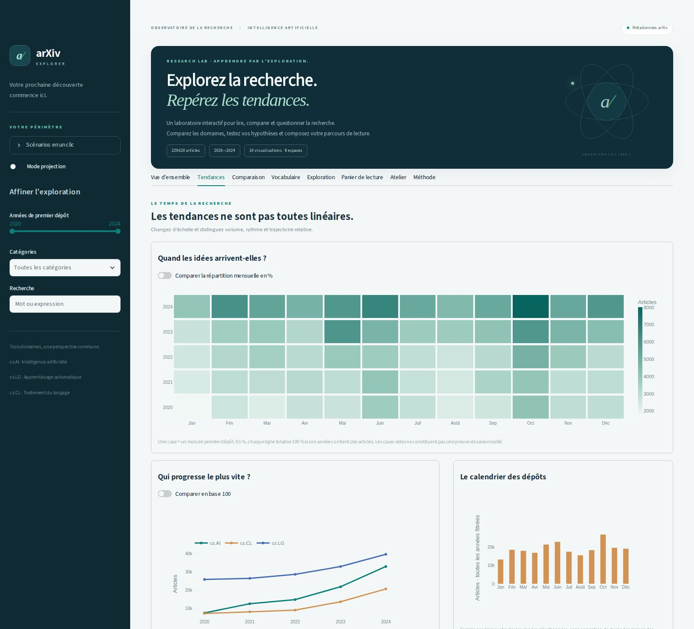

# BI-Project — arXiv Explorer

Projet BI d'Assia Ferjani (personne A) et Ines Makhlouf (personne B).

**Question :** comment évoluent les dépôts d'articles dans les catégories
`cs.AI`, `cs.LG` et `cs.CL` entre 2020 et 2024, et comment retrouver les articles
correspondant à un sujet ?

**Public :** étudiants et personnes qui commencent une veille scientifique.

Le dataset choisi est [arXiv sur Kaggle](https://www.kaggle.com/datasets/Cornell-University/arxiv).
Le projet contient la préparation des données, les indicateurs et l'application
interactive. Le snapshot réel a été traité : **229 620 articles** retenus sur
2020–2024. Consulter le [bilan vérifié](docs/data_findings.md) pour la
provenance, les chiffres et les limites.

Toutes les contributions sont fusionnées dans `main` après revue par l'autre
membre du binôme. La [checklist de revue](docs/review_checklist.md) décrit les
vérifications reproduites avant fusion.

## Exemple à présenter en classe

Le projet sert maintenant de démonstrateur pédagogique : **10 visualisations
et 8 espaces interactifs**, avec questions à révéler, scénarios en un clic et
mode projection. Les calculs restent vérifiables sur les articles sources.
Voir le [parcours enseignant](docs/teacher_demo.md).



| Espace | Ce que l'on peut explorer |
| --- | --- |
| Vue d'ensemble | Indicateurs, évolution, croissance, calendrier et communautés |
| Tendances | Carte thermique mensuelle, base 100 et saisonnalité descriptive |
| Comparaison | Volumes, intersection/Jaccard et combinaisons exclusives |
| Vocabulaire | Fréquence dans les titres et duel d'expressions normalisé |
| Exploration | Recherche, pagination, article aléatoire et fiches |
| Panier de lecture | Sélection indépendante des filtres et export CSV |
| Atelier | Hypothèses, défis et compétences BI à discuter |
| Méthode | Source, unités, dénominateurs et limites |

La suite complète compte **114 tests**. La navigation et les scénarios ont été
contrôlés dans Chromium sur ordinateur et mobile. Les agrégats du calendrier et
des combinaisons ont été rapprochés des 229 620 articles réels.

[Calendrier et trajectoires](docs/assets/showcase-trends.jpg) ·
[Recouvrements](docs/assets/showcase-connections.jpg) ·
[Vocabulaire](docs/assets/showcase-vocabulary.jpg) ·
[Atelier](docs/assets/showcase-workshop.jpg) ·
[Mobile](docs/assets/showcase-mobile.jpg)

## Utilisation et démonstration

- [Guide utilisateur](docs/user_guide.md) : filtres, graphiques, recherche et export.
- [Scénario de démonstration](docs/demo_script.md) : parcours et explications à préparer.
- Graphiques interactifs : dépôts annuels, croissance et comparaison des catégories.
- Chiffres annuels consultables en tableau ; variation non calculable explicitée.
- Recherche, pagination, fiche article et export de tous les résultats filtrés.

Les tests vérifient notamment que les valeurs envoyées aux graphiques changent
avec les filtres, sans double comptage ni division par zéro.

## Répartition

| Personne | Réalisation | Revue |
| --- | --- | --- |
| Assia — A | Préparation des données, qualité, calculs et tests | PR d'Ines |
| Ines — B | Interface, graphiques, recherche, export et guide utilisateur | PR d'Assia |

Chaque personne travaille sur une branche par tâche. Une PR est relue par l'autre
avant fusion vers `main`. Voir [le guide de collaboration](CONTRIBUTING.md).

### Contributions réalisées

| PR | Auteure | Contenu | Relue par |
| --- | --- | --- | --- |
| #10 | Assia | Pipeline de préparation, données fictives, documentation de base | Ines |
| #12 | Ines | Chargement des articles, filtres années / catégories, structure des écrans | fusionnée par Assia, sans revue écrite |
| #13 | Ines | Recherche, fiche d'un article, pagination, export CSV | Assia |
| #14 | Ines | Maquette des écrans et décisions d'interface | Assia |
| #15 | Assia | Indicateurs (`src/metrics.py`) | Ines |
| #16 | Assia | Validation sur le snapshot réel, profil et bilans | Ines |
| #17 | Assia | Graphiques annuels et par catégorie, guide utilisateur | Ines |
| #18 | Assia | Refonte visuelle | Ines |
| #19 | Assia | Dix visualisations et parcours pour la classe | Ines |
| #20 | Ines | Intégration de #18 et #19, déjà relues, dans la branche commune | sans revue (aucun changement nouveau) |

Les deux membres ont utilisé une aide IA (Codex pour Assia, Claude Code pour
Ines). Le détail des demandes, des défauts trouvés et des vérifications est dans
[docs/ai_usage.md](docs/ai_usage.md).

## Installer — Python 3.11 ou plus récent

Testé avec Python 3.11 et 3.14.

Depuis la racine du dépôt, sur Linux / macOS :

```bash
python3 -m venv .venv
source .venv/bin/activate
python -m pip install -r requirements.txt
```

Sous Windows PowerShell : `py -m venv .venv`, puis
`.venv\Scripts\Activate.ps1` et la même commande d'installation.

Sur Debian / Ubuntu, si la première commande échoue avec « ensurepip is not
available », installer d'abord le paquet `python3-venv`.

## Essayer sans télécharger Kaggle

Le fichier de démonstration est **fictif** : il sert à vérifier le fonctionnement,
pas à produire des conclusions scientifiques. Il contient 6 lignes, dont
3 articles retenus, 1 doublon, 1 article hors période et 1 hors catégories.

```bash
python -m src.prepare_data \
  --input data/sample/arxiv_demo.jsonl \
  --output data/processed/demo.parquet \
  --source-version synthetic-demo-v1
python -m pytest
```

Résultats : `data/processed/demo.parquet` et
`data/processed/demo.quality.json`. Les sorties sont ignorées par Git.
Les compteurs de qualité sont aussi affichés dans le terminal.

## Préparer les vraies données

1. Depuis la page Kaggle, télécharger et décompresser
   `arxiv-metadata-oai-snapshot.json`. Les PDF des articles ne sont pas nécessaires.
2. Placer ce fichier dans `data/raw/` (créer le dossier si nécessaire).
3. Noter la version exacte du dataset dans Kaggle et la date du téléchargement.
4. Remplacer `VERSION_KAGGLE` ci-dessous par cette version, puis lancer :

```bash
python -m src.prepare_data \
  --input data/raw/arxiv-metadata-oai-snapshot.json \
  --output data/processed/articles.parquet \
  --source-version VERSION_KAGGLE \
  --start-year 2020 --end-year 2024 \
  --categories cs.AI cs.LG cs.CL
```

Le programme lit le fichier entier progressivement et produit un Parquet et un
rapport JSON : empreinte SHA-256 de la source, paramètres, versions logicielles,
date d'exécution et compteurs de qualité. La mémoire contient un bloc d'articles
et les identifiants déjà retenus ; elle ne contient pas le snapshot complet.
Le premier traitement réel et son empreinte source sont documentés dans
[docs/data_findings.md](docs/data_findings.md). Le numéro de version Kaggle de
ce téléchargement n'a pas été renseigné ; il ne peut pas être déduit du nom du ZIP.

Pour vérifier le Parquet et recalculer le bilan :

```bash
python -m src.profile_data \
  --input data/processed/articles.parquet \
  --output reports/arxiv_profile.json
```

## Contrat de données pour l'interface

```python
import pandas as pd

articles = pd.read_parquet("data/processed/articles.parquet")
total = articles["id"].nunique()
```

`categories` et `selected_categories` sont des colonnes de listes en Parquet ;
pandas peut les restituer comme des tableaux NumPy. Ne pas les traiter comme des
chaînes séparées par des virgules. Utiliser `explode` pour compter par catégorie.
Tous les indicateurs devront utiliser le même ensemble filtré d'articles.

La date de référence est celle de **v1**, jamais `update_date`. Un article portant
deux catégories compte une fois au total, mais dans chacune des deux catégories.

## Structure du dépôt

```text
src/prepare_data.py       préparation JSONL → Parquet + rapport qualité
src/profile_data.py       contrôle du contrat et bilan du Parquet
src/metrics.py            calculs des indicateurs BI
src/discovery.py          agrégats exploratoires (calendrier, recouvrements, vocabulaire)
reports/                 petits bilans vérifiés, sans les articles
data/sample/             données fictives de démonstration
scripts/build_pages.py    version statique pour GitHub Pages
pages/                   page d'accueil stlite et données en ligne sans résumés
app.py                   point d'entrée de l'application Streamlit
ui/                      chargement, filtres et écrans de l'interface
tests/                   cas contrôlés pour le traitement et l'interface
docs/data_dictionary.md   colonnes préparées et règles pour l'interface
docs/methodology.md       périmètre, règles, limites et provenance
docs/design.md            écrans et décisions d'interface
docs/user_guide.md        guide utilisateur
docs/demo_script.md       scénario de soutenance
docs/ai_usage.md          aide IA utilisée et vérifications
docs/next_steps.md        ce qu'il reste à faire avant la soutenance
```

## Lancer l'application

Après la préparation des données (vraies ou de démonstration) :

```bash
python -m streamlit run app.py
```

L'application charge `data/processed/articles.parquet` s'il existe, sinon
`data/processed/demo.parquet` en affichant un bandeau « données fictives ».
Sans aucun des deux, elle indique la commande à lancer.

## Version en ligne (GitHub Pages)

GitHub Pages ne sert que des fichiers statiques : l'application y tourne dans le
navigateur avec [stlite](https://github.com/whitphx/stlite), sans serveur Python.
Adresse une fois Pages activé : <https://assiaferjani.github.io/BI-Project/>.

- **Données.** `pages/data/articles.parquet` contient les 229 620 articles
  **sans les résumés** (12,7 Mo au lieu de 180 Mo). Les chiffres et graphiques
  sont identiques ; la recherche porte sur les titres seulement et un bandeau
  le signale. C'est la seule sortie de traitement versionnée.
- **Déploiement.** Chaque fusion dans `main` lance
  `.github/workflows/pages.yml`. Réglage à faire une fois par une
  administratrice : Settings → Pages → Source « GitHub Actions ». Sur un dépôt
  privé, Pages exige une offre GitHub payante ; le site publié est public.
- **Premier chargement.** Le navigateur télécharge Python et les bibliothèques :
  compter de vingt secondes à quelques minutes selon la connexion.

Régénérer les données en ligne après une nouvelle préparation, et tester le
site en local :

```bash
python scripts/build_pages.py slim
python scripts/build_pages.py site
python -m http.server 8000 -d _site
```

Les résultats réels documentés concernent uniquement le snapshot et le périmètre
du [bilan de validation](docs/data_findings.md), pas l'ensemble de la recherche.
